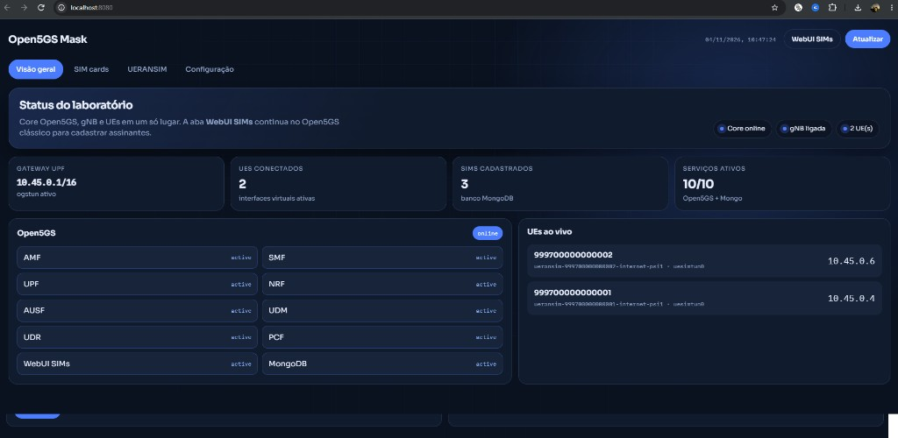

# Open5GS Mask

**Dashboard e utilitários** para facilitar testes com [Open5GS](https://open5gs.org/) + [UERANSIM](https://github.com/aligungr/UERANSIM).

Não substitui o core Open5GS. Complementa a WebUI oficial com visão de status do laboratório, UEs conectados, gNB e edição rápida dos IPs principais (AMF / SMF / UPF / gNB).

<p align="center">
  
  
  
</p>

---

## Para que serve

| Situação | Sem o Mask | Com o Mask |
| --- | --- | --- |
| Ver se AMF/SMF/UPF estão no ar | `systemctl` em vários serviços | painel único |
| Ver UEs com IP `10.45.0.x` | `ip` / `ip netns` | lista ao vivo |
| Ligar gNB / UE de teste | vários terminais e YAMLs | botões + configs prontas |
| Ajustar IP do AMF ou da gNB | editar YAML na mão | formulário na aba **Configuração** |
| Medir vazão e latência com vários UEs | vários `iperf3` e `ping` | aba **Teste**, com gráficos e logs |
| Cadastrar SIM (K/OPc) | WebUI Open5GS | continua na WebUI oficial (`:9999`) |

Ideal para laboratório, TCC, demonstrações e validação rápida de sessão PDU.

<p align="center">
  
</p>

---

## Arquitetura (lab em um host)

```text
                 ┌─────────────────────────────┐
                 │     Open5GS Mask (:8080)    │
                 │  status · UEs · config IPs  │
                 └──────────────┬──────────────┘
                                │
     ┌──────────────────────────┼──────────────────────────┐
     │                          │                          │
┌────▼────┐              ┌──────▼──────┐            ┌──────▼──────┐
│ Open5GS │◄── NGAP ─────│  UERANSIM   │── GTP-U ──►│    UPF      │
│  AMF…   │              │  gNB + UE   │            │ ogstun      │
└────┬────┘              └─────────────┘            │ 10.45.0.1   │
     │                                              └──────┬──────┘
     │  MongoDB + WebUI SIMs (:9999)                       │
     └─────────────────────────────────────────────────────┘
                      UE recebe 10.45.0.2, .3, .4…
```

No mesmo Linux, o UE deve usar `useNamespace: true` (já vem nos exemplos) para o tráfego da TUN não conflitar com o `ogstun`.

---

## Requisitos

- Linux (Ubuntu 22.04/24.04 recomendado) **ou** WSL2 — ver [docs/WINDOWS-WSL.md](docs/WINDOWS-WSL.md)
- [Open5GS](https://open5gs.org/open5gs/docs/guide/01-quickstart/) instalado e rodando
- MongoDB (usado pelo Open5GS)
- [UERANSIM](https://github.com/aligungr/UERANSIM) compilado (ex.: `/opt/UERANSIM`)
- Node.js 18+ (para o dashboard)
- Capacidades de rede: `sctp`, `tun`, `ip_forward`

---

## Linux — core e RAN no mesmo host

Use este caminho quando Open5GS e UERANSIM estão na mesma máquina (Ubuntu nativo ou VM).

```bash
git clone https://github.com/edusassi/open5gs-mask.git
cd open5gs-mask

sudo bash scripts/install-dashboard.sh
sudo bash scripts/install-lab-helpers.sh

# opcional: 3 SIMs de demonstração alinhados aos YAMLs em configs/
mongosh open5gs scripts/seed-demo-sims.js
```

O script instala o dashboard em `/opt/open5gs-mask-dashboard` e cria o serviço `open5gs-mask-dashboard`.

```bash
sudo systemctl status open5gs-mask-dashboard
sudo systemctl restart open5gs-mask-dashboard
```

Abra:

- **Dashboard Mask:** http://localhost:8080  
- **WebUI Open5GS (SIMs):** http://localhost:9999 — usuário `admin` / senha `1423` (padrão Open5GS; altere em laboratório)

## Linux — core e RAN em máquinas diferentes

Use este caminho quando o Open5GS fica em uma VM e o UERANSIM em outra, na mesma rede.

1. Na VM do **core**, instale o dashboard como na seção anterior.
2. Na VM do **UERANSIM**, copie o helper e permita que o core o chame por SSH:

```bash
sudo install -m 755 dashboard/ran/mask-ran /usr/local/sbin/mask-ran
echo 'admin ALL=(root) NOPASSWD: /usr/local/sbin/mask-ran' | sudo tee /etc/sudoers.d/open5gs-mask
sudo visudo -cf /etc/sudoers.d/open5gs-mask
```

Se os binários não estiverem em `/opt/UERANSIM`, exporte `MASK_GNB_BIN`, `MASK_UE_BIN`, `MASK_GNB_CFG` e `MASK_UE_CFG_DIR` antes de chamar o helper.

3. Na VM do core, crie uma chave só para o dashboard e autorize a chave pública na VM do UERANSIM (`~/.ssh/authorized_keys` do usuário da RAN). Não use senha no serviço.

4. Aponte o serviço para essa VM. Exemplo em `/etc/systemd/system/open5gs-mask-dashboard.service`:

```ini
Environment=RAN_HOST=192.168.122.20
Environment=RAN_USER=admin
Environment=RAN_SSH_KEY=/root/.ssh/id_mask
Environment=GNB_LINK_IP=192.168.122.20
```

```bash
sudo systemctl daemon-reload
sudo systemctl restart open5gs-mask-dashboard
```

Sem `RAN_HOST`, o painel olha só a máquina local. A aba **Teste** precisa de `RAN_HOST` quando a gNB não está no core: ela sobe a gNB e os UEs, roda iperf3 por 1 a 5 minutos e mede a latência com ping. Os resultados ficam em `testes/` dentro do diretório do dashboard.

## Windows

O UERANSIM não roda no Windows nativo, porque falta SCTP. Há dois usos comuns.

**Laboratório inteiro no PC.** Instale Ubuntu no WSL2 e siga a seção “Linux — core e RAN no mesmo host” dentro dessa distro. O passo a passo está em [docs/WINDOWS-WSL.md](docs/WINDOWS-WSL.md). Atalhos: `windows/iniciar-lab.ps1`, `windows/parar-lab.ps1` e `windows/ver-lab.ps1`.

**Laboratório já está em um servidor Linux.** Deixe o dashboard no Linux e, no Windows, só abra um túnel SSH:

```powershell
ssh -L 8080:127.0.0.1:8080 -L 9999:127.0.0.1:9999 usuario@servidor-do-core
```

Depois abra http://localhost:8080 e http://localhost:9999 no navegador do Windows.

---

## Subir gNB e UEs (manual)

Com o **core Open5GS** ativo e a interface `ogstun` em `10.45.0.1`:

**Terminal 1 — gNB**

```bash
/opt/UERANSIM/build/nr-gnb -c /opt/open5gs-lab/manual-gnb.yaml
```

Espere: `NG Setup procedure is successful`

**Terminal 2 — UE 1**

```bash
/opt/UERANSIM/build/nr-ue -c /opt/open5gs-lab/manual-ue.yaml
```

**Terminal 3 — UE 2**

```bash
/opt/UERANSIM/build/nr-ue -c /opt/open5gs-lab/manual-ue-2.yaml
```

**Teste de conectividade**

```bash
ip netns exec ueransim-999700000000001-internet-psi1 ping -c 4 10.45.0.1
ip netns exec ueransim-999700000000002-internet-psi1 ping -c 4 10.45.0.1
```

Os exemplos usam PLMN **999/70**, APN **internet**, e as chaves de teste do UERANSIM:

| IMSI | Arquivo |
| --- | --- |
| `999700000000001` | `configs/open5gs-ue-1.yaml` |
| `999700000000002` | `configs/open5gs-ue-2.yaml` |
| `999700000000003` | `configs/open5gs-ue-3.yaml` |

K / OPc de demo: `465B5CE8B199B49FAA5F0A2EE238A6BC` / `E8ED289DEBA952E4283B54E88E6183CA`

---

## Dashboard

Abas:

1. **Visão geral** — serviços Open5GS, gateway UPF, contagem de UEs/SIMs  
2. **SIM cards** — assinantes no MongoDB e quem está conectado (cadastro continua na WebUI oficial)  
3. **UERANSIM** — ligar/parar gNB e UE, logs  
4. **Configuração** — IPs principais de gNB, AMF, SMF e UPF (gera backup `.bak-*` antes de gravar)  
5. **Teste** — escolhe os SIMs, a duração (1 a 5 minutos) e mostra vazão de subida, descida e latência

Variáveis de ambiente úteis do serviço:

| Variável | Padrão | Função |
| --- | --- | --- |
| `PORT` | `8080` | porta HTTP |
| `GNB_CFG` | `/opt/open5gs-lab/manual-gnb.yaml` | YAML da gNB |
| `UE_CFG` | `/opt/open5gs-lab/manual-ue.yaml` | YAML do UE 1 |
| `MONGO_URI` | `mongodb://127.0.0.1:27017` | banco Open5GS |
| `RAN_HOST` | vazio | IP da VM do UERANSIM, se for separada do core |
| `RAN_USER` | `admin` | usuário SSH dessa VM |
| `RAN_SSH_KEY` | `/root/.ssh/id_mask` | chave usada pelo serviço |
| `GNB_LINK_IP` | o mesmo que `RAN_HOST` | IP que os UEs usam para achar a gNB |
| `IPERF_TARGET` | `10.45.0.1` | destino do iperf3 (gateway do UPF) |

```bash
sudo systemctl status open5gs-mask-dashboard
sudo systemctl restart open5gs-mask-dashboard
```

---

## Estrutura do repositório

```text
open5gs-mask/
├── dashboard/           # API Node + UI
├── configs/             # exemplos gNB / UE1–3
├── scripts/             # instalação e helpers do lab
├── windows/             # atalhos PowerShell (WSL)
├── docs/                # notas extras
├── LICENSE
└── README.md
```

---

## Segurança

Ferramenta para **laboratório**. Não exponha as portas `8080` / `9999` na internet pública. Altere a senha da WebUI Open5GS. As chaves K/OPc dos exemplos são públicas de demonstração.

---

## Créditos

- [Open5GS](https://open5gs.org/) — core 4G/5G open source  
- [UERANSIM](https://github.com/aligungr/UERANSIM) — emulador gNB/UE 5G SA  
- Este projeto — camada de facilidade para configuração e visualização de testes

Licença do Mask: **MIT** (veja `LICENSE`). Open5GS e UERANSIM mantêm as licenças próprias.

---

## Contribuindo

Issues e PRs são bem-vindos em [github.com/edusassi/open5gs-mask](https://github.com/edusassi/open5gs-mask).

Sugestões úteis: screenshots do dashboard, suporte a mais NFs na tela de config, e pacote Debian/systemd mais opinativo.
